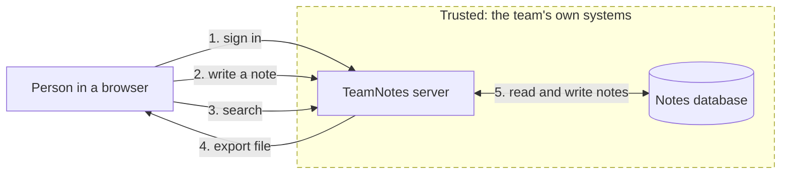

**Threat modeling** is a structured way to look at a piece of software and ask what could go wrong with it, before an attacker or an accident asks for you. You sketch the system, find the threats that apply to the sketch, and decide what to do about each. The output is a short, ranked security to-do list.

It rests on two words from the [first article](/security/what-secure-software-means/): an **asset** is something worth protecting, and a **threat** is something that could harm it. The whole method follows four questions from the [Threat Modeling Manifesto](https://www.threatmodelingmanifesto.org/):

1. What are we working on?
2. What can go wrong?
3. What are we going to do about it?
4. Did we do a good enough job?

For a small app, one sitting of about half an hour is a good first target (a teaching goal, not a rule). OWASP advises starting early, ideally during design, and keeping the model up to date. Mozilla's web docs add that it does not need to be perfect to be useful.

We will answer the four questions for TeamNotes, the small team notes app used across this path. People sign in, write notes, search them and export them. The sketch, threats and ranking below are an illustration.

## Question 1: what are we working on?

The usual answer is a **data-flow diagram**: boxes for the parts of the system, arrows for the data that moves between them. A whiteboard is enough, as long as you save the picture where the team can update it. TeamNotes has three boxes: a **person in a browser**, the **TeamNotes server** (the code the team runs) and the **database** where notes live.



Finally, mark the assets on the sketch: the team's **notes** in the database and each user's **login**.

## The trust boundary: where untrusted data comes in

The most useful line on the sketch is the **trust boundary**: the point where data crosses from places you do not control into your own trusted code. Mozilla's guide puts it simply: anything that happens in the browser, or comes from a user's input, is untrusted. The browser belongs to the user; the server and database belong to the team. So the dashed line runs between them.

Four arrows cross it: sign in, write a note, search and export. The database arrow stays inside. Problems gather where data crosses a boundary, so the team looks at those four arrows first.

## Question 2: what can go wrong?

The OWASP cheat sheet uses **STRIDE**, six prompts first developed at Microsoft. Each names one kind of threat and the property it breaks. The team walks the sketch with each prompt and writes the threat next to the box or arrow it affects. Threats are written as outcomes, never as attack steps:

| Prompt | Plain meaning | Breaks | TeamNotes threat |
|---|---|---|---|
| **S**poofing | pretending to be someone else | authentication | someone signs in as another user |
| **T**ampering | changing what should not change | integrity | typed text changes what the database or a teammate's page does |
| **R**epudiation | denying you did something | accountability | a note is deleted and nobody can tell who did it |
| **I**nformation disclosure | data reaching the wrong people | confidentiality | an outsider reads a team's notes through search, export or the note page |
| **D**enial of service | keeping people from using the app | availability | a flood of requests makes TeamNotes too slow for everyone |
| **E**levation of privilege | getting powers you should not have | authorization | a member does what only a team admin may do |

STRIDE is one common choice, not the only one, but six prompts are easy to remember.

## Rank the threats by chance and harm

Six threats is already a list, so rank it. This is a question of **risk**: how likely each threat is, and how much harm it would do. The team's ranking:

1. **An outsider reads a team's notes.** Notes are what TeamNotes exists to protect, and every feature that reads them is another way to leak them.
2. **Someone signs in as another user.** One stolen login opens everything that user can see.
3. **Typed text changes what the database or a page does.** Everything people type crosses the boundary.
4. **A member acts as a team admin.**

Lower for now: the missing delete record, and the flood of requests. They stay on the list; they just come later. The team works from the top.

## Question 3: what are we going to do about it?

Every threat gets one of four responses, as the cheat sheet names them: **mitigate** (make it less likely), **eliminate** (remove the feature that causes it), **transfer** (make someone else responsible) or **accept** (live with it, on purpose). For threat one, the team mitigates: every feature that reads notes checks the reader's team. Search and export already do; the list shows one more place that needs it, opening a single note. For the flood of requests, the team accepts the risk for now, writes down why, and keeps watching.

Each agreed mitigation becomes an ordinary requirement, so it can be built, reviewed and tested like any other (the [previous article](/security/secure-by-design-lifecycle/) shows how). The model itself can be a short file next to the code:

```text
# THREATS.md (TeamNotes, illustrative)
1  Outsider reads a team's notes   high    mitigate: team check on every read of notes
2  Sign in as another user         high    mitigate: (next sprint)
6  Flood of requests               low     accept for now; watch request rates
```

## Question 4: did we do a good enough job?

Check three things: does the sketch match the real app, does every threat have a response, and can each mitigation be tested? Then save the model with the code and update it whenever TeamNotes changes. If the team wants a tool, [OWASP Threat Dragon](https://owasp.org/www-project-threat-dragon/) is a free, open-source app for drawing these diagrams and listing threats per element.

## Recap

- Threat modeling answers four questions: what are we working on, what can go wrong, what are we going to do about it, and did we do a good enough job.
- Start with a data-flow sketch and draw the trust boundary; arrows that cross it get looked at first.
- Walk the sketch with the six STRIDE prompts and write threats as outcomes.
- Rank by chance and harm, give every threat a response, and turn mitigations into requirements.
- Keep the model next to the code and update it as the app grows.

## Sources

- [Threat Modeling Manifesto](https://www.threatmodelingmanifesto.org/)
- OWASP: [Threat Modeling Cheat Sheet](https://cheatsheetseries.owasp.org/cheatsheets/Threat_Modeling_Cheat_Sheet.html), [Threat Dragon](https://owasp.org/www-project-threat-dragon/)
- MDN Web Docs: [Threat modeling](https://developer.mozilla.org/en-US/docs/Web/Security/Threat_modeling)
- Microsoft Learn: [Threat Modeling Tool threats (STRIDE)](https://learn.microsoft.com/en-us/azure/security/develop/threat-modeling-tool-threats)
