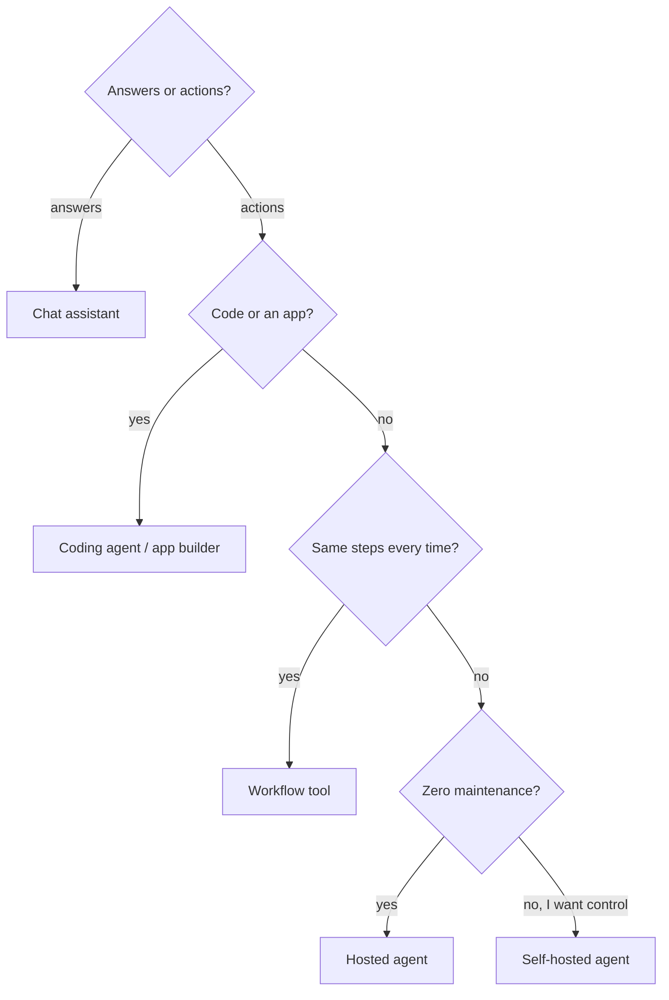

Choosing an AI agent means matching a job to the right kind of tool, then checking what it costs in money, setup time and upkeep. Most people do not need the most powerful option. Five questions narrow the field quickly, and a short cost check stops surprises on the first bill.

## Five questions

Answer them in order; stop at the first one that settles it.

1. **Do you want answers or actions?** If you mainly ask questions and draft text, a [chat assistant](/terms/ai-assistants-agents-and-bots-map/) is enough. If you want it to do things for you, keep going.
2. **Is the work code or an app?** Then you want a [coding agent or app builder](/terms/coding-agents-app-builders-and-workflow-agents/), not a personal assistant.
3. **Is it the same steps every time?** A form arrives, a row is added, an email goes out. A workflow tool such as n8n, Zapier or Make is often cheaper and more predictable than an open-ended agent.
4. **Do you want zero maintenance?** Choose a [hosted agent](/terms/hosted-ai-agents/), and start with the company whose plan you already pay for.
5. **Do you want control, any model, or your data at home?** Choose a [self-hosted agent](/terms/self-hosted-ai-agents/) such as OpenClaw or Hermes Agent on a server, or OpenDot on your own computer. If it must run around the clock, it needs a machine that stays on.

## What each kind really costs

Prices below were read on the official pages on 20 November 2026. They change often; treat them as a starting point and check before you pay.

| Kind | Example | Money | Setup | Who maintains it |
|---|---|---|---|---|
| Chat assistant | ChatGPT, Claude, Gemini, Microsoft Copilot | Free plans exist; Claude Pro $20/month | Minutes | The company |
| Hosted agent | ChatGPT dots | First dot included in ChatGPT Pro ($100/month) | Minutes | The company |
| Hosted agent | Claude Duet | Inside Claude Pro, Max or Ultra (US preview) | Minutes, after a waitlist | The company |
| Hosted agent | Grok Bot | From The X Subscription Premium ($30/month) | Minutes | The company |
| Hosted agent | Meta Muse | Free with a weekly limit; Power $20/month | Minutes | The company |
| Desktop agent | OpenDot | Free software, plus model use (or $0 with a local model) | An evening | You |
| Self-hosted agent | OpenClaw, Hermes Agent | Free software, plus model use, plus about $5/month for a server if always on | An evening | You |
| Coding agent | Claude Code, Codex, Cursor, Devin | Often inside a plan you have; Devin Pro $20/month | Minutes to an hour | The company (you review the code) |
| Workflow tool | n8n, Zapier Agents, Make | Varies by plan and by runs; n8n can be self-hosted | An afternoon per workflow | You build it; the company runs it, unless self-hosted |

"Model use" means you pay a provider per token through an [API key](/terms/what-is-an-api-key/). The size of that bill depends on the [model you pick](/terms/which-ai-model-should-i-use/) and how often the agent runs.

## Time is a cost too

A hosted agent costs minutes to set up and nothing to maintain. A self-hosted one can take an evening to set up and some time every week: updates, checking the usage page, fixing a broken connection. If you value your time, a $20 plan can be cheaper than a free tool.

## Common traps

- **Paying twice.** A ChatGPT or Claude subscription usually does not include API use. If your self-hosted agent needs a key, that is a second bill. Some tools let you sign in with your subscription instead; check first.
- **Too much access.** An agent that can read all your email and send messages can also make mistakes at scale. Turn on approvals for sending, paying and deleting, and give it only the apps it needs.
- **Forgotten servers.** A rented server that is never updated becomes a security risk. If you will not maintain it, choose a hosted agent.
- **Usage limits.** Hosted agents share your plan's allowance. Claude Duet's background checks, for example, count toward the same limits as your chats.
- **Regions.** Some agents are US-only for now, such as Claude Duet and Meta Muse. Tasks in Gemini is not offered in the EEA, Switzerland or the UK.
- **Too many tools.** One chat assistant and one agent for repeated work is enough for most people.

## Sara's final setup

Sara, a freelance designer, runs through the five questions.

For client research she keeps her Claude plan; that is question one. For her website she uses Claude Code, already in that plan; question two. Her monthly invoice reminders are the same steps every time, so she builds them in a workflow tool; question three.

That leaves her inbox. She lives in Germany, so Claude Duet is not open to her yet. She does not want to manage a server, so she skips self-hosting for now and tries Claude Cowork, also in her plan. Her extra monthly cost: nothing. If she later wants a Telegram agent that runs all day, she knows exactly what a $5 server and a model key would add.

## Recap

- Ask five questions in order: answers or actions, code, repeated steps, zero maintenance, control.
- Hosted agents cost a subscription and no upkeep; self-hosted agents cost model use, maybe a server, and your time.
- Prices change often; read them on the official page and note the date.
- Watch for paying twice, too much access, forgotten servers, usage limits and regions.
- Most people need one chat assistant and, at most, one agent.

## Sources

- [Claude pricing](https://claude.com/pricing)
- [ChatGPT pricing](https://chatgpt.com/pricing)
- [OpenAI: Introducing dots](https://openai.com/index/introducing-dots/)
- [Claude Duet](https://claude.com/product/claude-duet)
- [xAI docs: Plans and usage](https://docs.x.ai/x-subscription/pricing)
- [Meta Help Center: About Muse subscriptions](https://www.meta.com/help/subscriptions/1021145227643680/)
- [OpenDot](https://opendot.live/)
- [Hermes Agent](https://hermes-agent.nousresearch.com/open-source-ai-agent)
- [OpenClaw](https://openclaw.ai/)
- [Devin pricing](https://devin.ai/pricing)
- [n8n pricing](https://n8n.io/pricing/)
- [OpenAI Help Center: What is ChatGPT Plus?](https://help.openai.com/en/articles/6950777-what-is-chatgpt-plus)
- [Claude Help Center: What is the Pro plan?](https://support.claude.com/en/articles/8325606-what-is-the-pro-plan)
- [Gemini Apps Help: Tasks in Gemini](https://support.google.com/gemini/answer/17094507)
