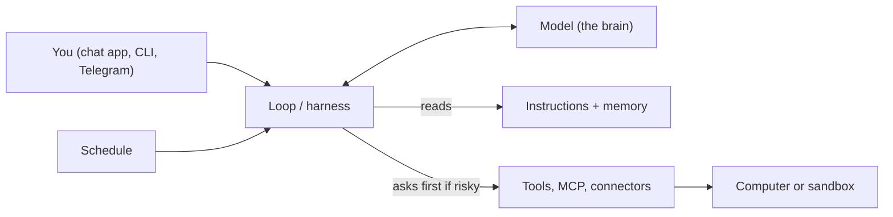

An AI agent is a program that keeps asking a language model what to do next, does it with tools, looks at the result and repeats until the job is done. The model is only one part. Files such as SKILL.md or AGENTS.md are another: plain text the program reads. Knowing the parts helps you see what a product actually offers and where things go wrong.

## The brain: a language model

The **model** writes every decision: "search the inbox", "draft a reply", "I am done". It is the same kind of [language model](/terms/what-is-an-llm/) that powers a chat app.

The program reaches the model in one of two ways. It calls a provider such as OpenAI or Anthropic over the internet, paid for with a key, or it runs an open model on your own computer. Many agents let you swap the model without changing anything else.

## The loop: the program that does the work

The part that makes an agent an agent is the **harness**, also called the loop or orchestrator. It is ordinary software that:

1. sends the goal and the conversation so far to the model,
2. reads the reply; if the model asked for a tool, runs that tool,
3. adds the result to the conversation,
4. repeats until the model says it is finished or a limit is reached.

Claude Code, the Codex CLI, OpenClaw and Hermes Agent are all harnesses. OpenDot, a desktop app, is built on one called pi. When people say "I installed an agent", they usually mean they installed a harness and connected it to a model.

## The hands: tools and connectors

A model can only write text. **Tools** turn that text into actions: a web search, a browser click, a shell command, sending an email. The model writes a request such as "call the search tool with these words", and the loop runs it.

Many tools now arrive through [MCP](/terms/what-is-mcp/), an open standard its makers compare to a USB-C port for AI apps. Products often call these "connectors" or "plugins". The idea is the same: a list of actions the loop may run for the model.

## The instructions: plain text the loop reads

This is where most confusion comes from. An agent's behaviour is shaped by text files, but those files are not the agent.

- The [system prompt](/terms/what-is-a-system-prompt/) is the standing instruction sent with every request: who the agent is and what it must never do.
- **AGENTS.md** is described by its makers as "a README for agents": build steps and house rules for a code project. Claude Code reads its own **CLAUDE.md** files, and can read AGENTS.md too, at the start of every session.
- A **SKILL.md** holds a recipe for one task. In Claude Code, a skill's full text loads only when it is used, so unused skills cost almost nothing.

A SKILL.md without a loop does nothing, the same way a recipe card does not cook.

## Memory and schedules

Each new session starts with a fresh [context window](/terms/what-is-a-context-window/), so an agent that remembers you must save notes somewhere and read them back. Many self-hosted agents keep **memory** as plain files or a small database.

A **schedule**, sometimes called a routine or cron job, starts the loop without you. That is how a proactive agent can check your inbox at 7:00. Hermes Agent and Suparagent, for example, both include schedulers.

## The computer, the channel and the brakes

Tools have to run somewhere. That **computer** can be the vendor's cloud machine, your own PC, a rented server, or a sealed container. NanoClaw puts each agent in its own Docker container, so a mistake stays inside the box.

The **channel** is how you talk to the agent: an app, a terminal, or a chat app such as Telegram or Slack. A "bot" is usually this layer.

**Approvals** are the brakes. Good harnesses pause before risky steps, such as sending, paying or deleting, and wait for you to say yes.

## One agent or a team

Some tasks are too big for one conversation. A **subagent** is a helper the loop starts for one side job. In Claude Code, each subagent works in its own context window and hands back only a summary, so the main conversation stays clean.

A multi-agent setup goes further: several named agents, each with its own job, tools and memory, coordinated by a lead. OpenDot's SuperDot and Suparagent's team leads work this way.

## Sara's inbox agent, taken apart

Sara, a freelance designer, wants help with her inbox. Her agent is made of:

- a model, paid for with a key;
- a harness running on a small server;
- a Gmail connector as its tool;
- a SKILL.md called "how I answer clients";
- a memory file of client names;
- a 7:00 schedule;
- an approval step before any email is sent;
- Telegram as the channel.

If replies sound wrong, she edits the skill. If it forgets a client, she checks the memory. If it never wakes up, the schedule or the server is the problem.

## Recap

- An agent is a loop (harness) that calls a model, runs tools and repeats.
- The model is the brain; it can usually be swapped.
- System prompts, AGENTS.md, CLAUDE.md and SKILL.md are instructions the loop reads, not the agent itself.
- Memory, schedules, a computer, a channel and approvals turn a loop into a useful assistant.
- A subagent is a helper for one side task; a multi-agent setup is a team with a lead.

## Sources

- [Anthropic: Building effective agents](https://www.anthropic.com/engineering/building-effective-agents)
- [OpenAI: Building agents](https://developers.openai.com/tracks/building-agents)
- [Claude Code docs: Skills](https://code.claude.com/docs/en/skills)
- [Claude Code docs: Memory and CLAUDE.md](https://code.claude.com/docs/en/memory)
- [Claude Code docs: Subagents](https://code.claude.com/docs/en/sub-agents)
- [AGENTS.md](https://agents.md/)
- [Model Context Protocol: Introduction](https://modelcontextprotocol.io/docs/getting-started/intro)
- [OpenDot](https://opendot.live/)
- [Hermes Agent](https://hermes-agent.nousresearch.com/open-source-ai-agent)
- [NanoClaw on GitHub](https://github.com/nanocoai/nanoclaw)
- [Suparagent on GitHub](https://github.com/Anil-matcha/suparagent)
